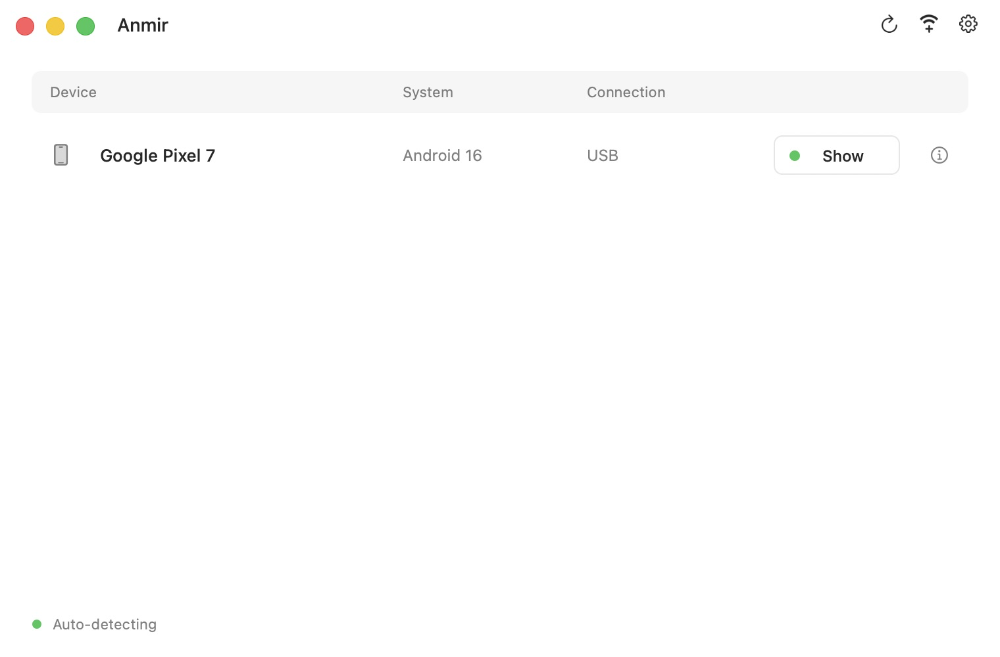
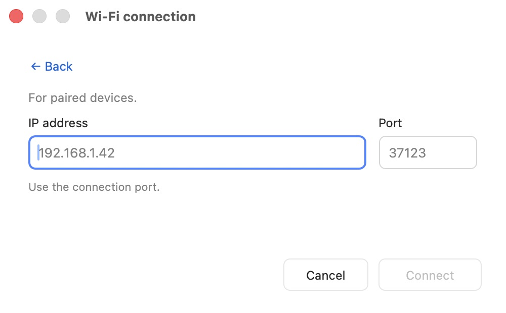
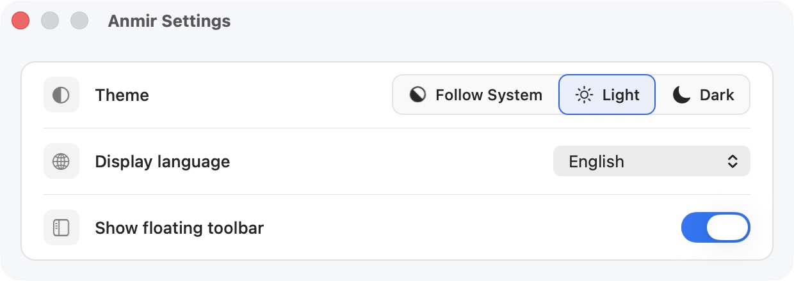

# Anmir

[简体中文](README.md) · [English](README.en.md)

Mirror and control Android from your Mac. Built on [scrcpy](https://github.com/Genymobile/scrcpy), Anmir adds native device management, wireless pairing and independent mirror windows. adb is included; no separate Homebrew or Android SDK installation is needed.

> /ˈæn.mɪr/ (AN-mir) · An(droid) + mir(ror)

## Highlights

- **USB and wireless:** automatic discovery, QR codes, pairing codes and manual addresses. Connections for the same phone are grouped together.
- **Multiple devices:** each mirror has its own window and Dock entry, with easy access to the device list.
- **Screenshots and recording:** copy screenshots to the clipboard, see recording duration and choose where to save recordings.
- **Native macOS interface:** floating controls for Back, Home, Recents, screenshots and recording; light, dark and system appearance.
- **Live language switching:** English, Simplified Chinese and Traditional Chinese. Settings are saved and shared across mirror windows.
- **Local connections:** no account or cloud relay. ADB connections remain available for debugging and logs.

## Download

**v0.1.0** · macOS 11+

| Mac processor | DMG | ZIP |
| --- | --- | --- |
| Apple Silicon (M series) | [arm64](https://github.com/laobie/Anmir/releases/download/v0.1.0/Anmir-0.1.0-arm64.dmg) | [arm64](https://github.com/laobie/Anmir/releases/download/v0.1.0/Anmir-0.1.0-arm64.zip) |
| Intel | [x86_64](https://github.com/laobie/Anmir/releases/download/v0.1.0/Anmir-0.1.0-x86_64.dmg) | [x86_64](https://github.com/laobie/Anmir/releases/download/v0.1.0/Anmir-0.1.0-x86_64.zip) |

[All releases](https://github.com/laobie/Anmir/releases) · [SHA-256 checksums](https://github.com/laobie/Anmir/releases/download/v0.1.0/SHA256SUMS) · [Source package](https://github.com/laobie/Anmir/releases/download/v0.1.0/Anmir-0.1.0-source.tar.gz)

USB mirroring requires Android 5.0+; wireless pairing requires Android 11+.

## Screenshots



<details>
<summary>Wireless connections and settings</summary>





</details>

## Quick start

1. Open the DMG, drag Anmir into Applications and open it.
2. Enable **Developer options → USB debugging** on your phone.
3. Connect with a USB data cable and allow debugging on the phone. A single ready device opens directly; with multiple devices, choose one from the list.

**Wireless:** connect both devices to the same network, enable **Developer options → Wireless debugging** on the phone, then click the Wi-Fi add button in Anmir. Use the phone's **Pair device with QR code** scanner or switch to a pairing code. Already paired devices can also connect by address.

**Everyday controls:** use the floating toolbar to capture screenshots, record or return to Home. Open Settings with the gear in either the device list or a mirror window, or press `⌘,`.

If macOS blocks the first launch, double-click **Privacy & Security** in the installer and choose **Open Anyway** for Anmir. This version is not notarized; see [Apple's instructions](https://support.apple.com/102445).

## Command line

The bundled `anmir` command accepts scrcpy options:

```sh
/Applications/Anmir.app/Contents/MacOS/anmir --help
/Applications/Anmir.app/Contents/MacOS/anmir --serial DEVICE_SERIAL
```

## Documentation and feedback

[Building and LGPL relinking](doc/build-anmir.md) · [Shortcuts](doc/shortcuts.md) · [Connections](doc/connection.md) · [Audio](doc/audio.md) · [macOS architecture](doc/macos-architecture.md)

Report issues in [Issues](https://github.com/laobie/Anmir/issues), including the version, operating systems and connection method.

## Release history

| Version | Date | Changes | Release |
| --- | --- | --- | --- |
| v0.1.0 | 2026-10-25 | Initial release: native device management, USB/wireless mirroring, screenshots, recording and localization. | [Release](https://github.com/laobie/Anmir/releases/tag/v0.1.0) |

## License

Independently maintained, based on scrcpy v4.1. Not an official Genymobile project.

Licensed under [Apache 2.0](LICENSE), with [upstream attribution](NOTICE) preserved. Dependency licenses are listed in [THIRD_PARTY.md](THIRD_PARTY.md).

Android is a trademark of Google LLC.
