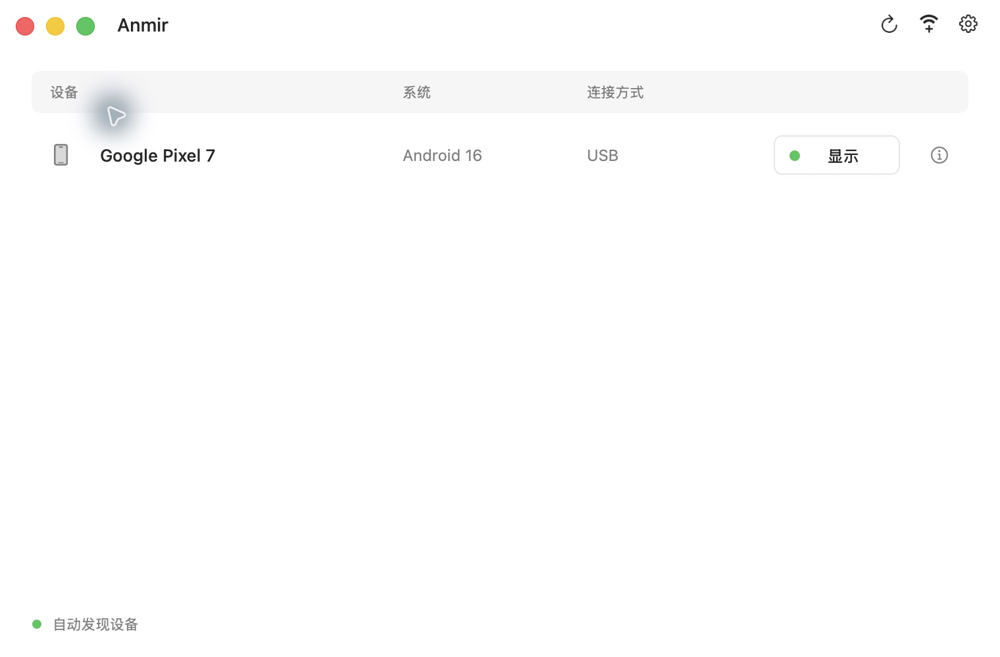
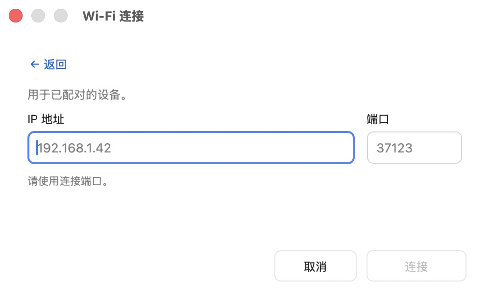
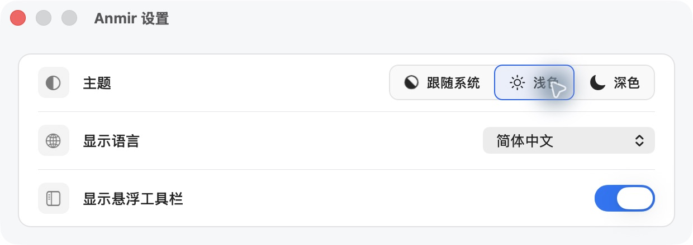

# Anmir

[简体中文](README.md) · [English](README.en.md)

在 Mac 上投屏和控制 Android。基于 [scrcpy](https://github.com/Genymobile/scrcpy)，提供原生设备管理、无线配对和独立投屏窗口。内置 adb，无需另装 Homebrew 或 Android SDK。

> /ˈæn.mɪr/（安米尔）· An(droid) + mir(ror)

## 特色功能

- **USB 与无线连接**：自动发现设备，支持扫码、配对码和手动地址；同一手机的连接合并展示。
- **多设备投屏**：每台设备拥有独立窗口和 Dock 入口，可随时返回设备列表。
- **截图与录屏**：截图复制到剪贴板；录屏显示时长，并可选择保存位置。
- **原生 macOS 体验**：悬浮工具栏提供返回、主页、最近任务、截图和录屏，支持明暗主题与跟随系统。
- **多语言切换**：简体中文、繁体中文、英文即时切换，设置自动保存并同步到投屏窗口。
- **本地直连**：无需账号或云端转发，ADB 连接仍可用于调试和日志采集。

## 下载

**v0.1.0** · macOS 11+

| Mac 芯片 | DMG | ZIP |
| --- | --- | --- |
| Apple Silicon（M 系列） | [arm64](https://github.com/laobie/Anmir/releases/download/v0.1.0/Anmir-0.1.0-arm64.dmg) | [arm64](https://github.com/laobie/Anmir/releases/download/v0.1.0/Anmir-0.1.0-arm64.zip) |
| Intel | [x86_64](https://github.com/laobie/Anmir/releases/download/v0.1.0/Anmir-0.1.0-x86_64.dmg) | [x86_64](https://github.com/laobie/Anmir/releases/download/v0.1.0/Anmir-0.1.0-x86_64.zip) |

[全部版本](https://github.com/laobie/Anmir/releases) · [SHA-256 校验](https://github.com/laobie/Anmir/releases/download/v0.1.0/SHA256SUMS) · [源码包](https://github.com/laobie/Anmir/releases/download/v0.1.0/Anmir-0.1.0-source.tar.gz)

USB 投屏需 Android 5.0+，无线配对需 Android 11+。

## 界面预览



<details>
<summary>查看无线连接与设置</summary>





</details>

## 快速开始

1. 打开 DMG，将 Anmir 拖入“应用程序”并打开。
2. 在手机上开启“开发者选项 → USB 调试”。
3. 用支持数据传输的 USB 线连接，在手机上允许调试授权。一台可用设备时直接投屏，多台设备时从列表选择。

**无线连接**：手机与 Mac 连到同一网络，开启手机“开发者选项 → 无线调试”，点击设备列表的 Wi-Fi 加号。用手机的“使用二维码配对设备”扫码，或切换配对码；已配对的设备也可输入地址连接。

**日常操作**：在投屏窗口旁使用工具栏截图、录屏或返回主页。设备列表和投屏窗口右上角的齿轮均可打开设置，也支持 `⌘,`。

首次打开若被 macOS 拦截，双击安装包中的 **Privacy & Security**，在系统页选择“仍要打开”。当前版本未经 Apple 公证，详见 [Apple 说明](https://support.apple.com/102445)。

## 命令行

应用内的 `anmir` 命令兼容 scrcpy 参数：

```sh
/Applications/Anmir.app/Contents/MacOS/anmir --help
/Applications/Anmir.app/Contents/MacOS/anmir --serial DEVICE_SERIAL
```

## 文档与反馈

[构建与 LGPL 重新链接](doc/build-anmir.md) · [快捷键](doc/shortcuts.md) · [连接](doc/connection.md) · [音频](doc/audio.md) · [macOS 架构](doc/macos-architecture.md)

反馈请到 [Issues](https://github.com/laobie/Anmir/issues)，附上版本、系统和连接方式。

## 更新记录

| 版本 | 日期 | 更新内容 | 发布页 |
| --- | --- | --- | --- |
| v0.1.0 | 2026-10-25 | 首次发布：原生设备管理、USB/无线投屏、截图录屏与多语言。 | [Release](https://github.com/laobie/Anmir/releases/tag/v0.1.0) |

## 开源许可

基于 scrcpy v4.1 独立维护，非 Genymobile 官方项目。

采用 [Apache 2.0](LICENSE)，保留[上游署名](NOTICE)；依赖许可证见 [THIRD_PARTY.md](THIRD_PARTY.md)。

Android is a trademark of Google LLC.
