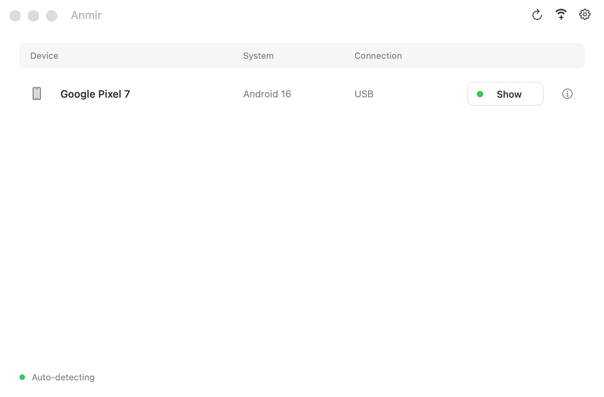
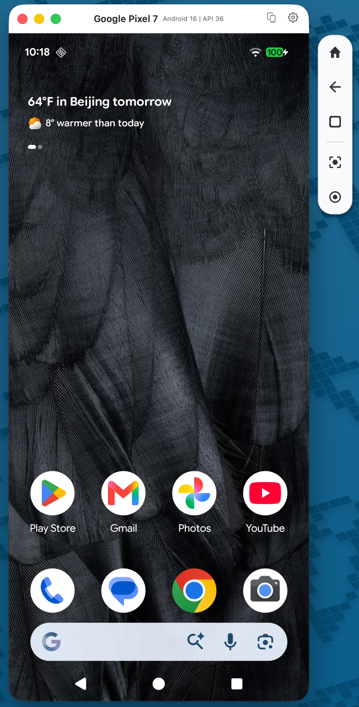

<p align="center">
  
</p>

<h1 align="center">Anmir</h1>

<p align="center"><strong>Mirror and control Android devices on your Mac.</strong></p>

<p align="center">
  <a href="README.md">English</a> · <a href="README.zh-CN.md">简体中文</a>
</p>

Built on [scrcpy](https://github.com/Genymobile/scrcpy), with QR pairing, device management and floating controls in a native macOS interface.

adb is included, with no separate Homebrew or Android SDK installation needed. Mirroring stays local and requires no account or cloud relay.

> /ˈæn.mɪr/ (AN-mir) · An(droid) + mir(ror)

[Download](#download) · [Screenshots](#screenshots) · [Quick start](#quick-start) · [Release history](#release-history)

## Highlights

- **Built-in wireless pairing:** scan Anmir's QR code with your Android device, or enter a pairing code. Connect paired devices by IP address and port.
- **Company-network pairing:** use Anmir Connect when mDNS is blocked between subnets, with reconnection after Wi-Fi returns.
- **Unified device management:** discover Android devices and group each device's USB and wireless connections. Each mirror has its own window and Dock entry.
- **Floating controls:** Back, Home, Recents, screenshots and recording beside the mirror window.
- **Screenshots and recording:** copy device screenshots to your Mac's clipboard. Start and stop recording while mirroring, check elapsed time and choose a save location.
- **Appearance and language:** light, dark or system appearance; live switching between English, Simplified Chinese and Traditional Chinese. Settings apply to mirror windows too.

## Download

[Latest release](https://github.com/houzi3/Anmir/releases/latest) · macOS 11+ · Apple Silicon / Intel

Choose **arm64** for Apple Silicon or **x86_64** for Intel.

## Screenshots

<table>
  <tr>
    <th>Device list</th>
    <th>Screen mirroring and floating controls</th>
  </tr>
  <tr>
    <td valign="top"></td>
    <td valign="top"></td>
  </tr>
</table>

## Quick start

### Install the app

Open the DMG, drag Anmir into Applications and open it.

<details>
<summary>If macOS blocks the first launch</summary>

1. Double-click the **Privacy & Security** shortcut in the DMG window or extracted ZIP folder.
2. In Privacy & Security, choose **Open Anyway** for Anmir.

The app is not notarized; see [Apple's instructions](https://support.apple.com/102445).

</details>

### USB connection · Android 5.0+

1. Enable **Developer options → USB debugging** on your Android device.
2. Connect it to your Mac with a USB data cable and allow USB debugging on the device.

A single ready device opens directly; with multiple devices, choose one from the device list.

### Wireless connection · Android 11+

1. Connect your device and Mac to networks that can reach each other. Enable **Developer options → Wireless debugging** on the Android device.
2. Click the **Wi-Fi add button** in Anmir and choose a connection method:

<table>
  <tr>
    <th nowrap>Method</th>
    <th>Action</th>
  </tr>
  <tr>
    <td nowrap>QR pairing</td>
    <td>Select <strong>Pair device with QR code</strong> on the Android device and scan the code shown in Anmir.</td>
  </tr>
  <tr>
    <td nowrap>Pairing code</td>
    <td>Select the discovered device and enter its pairing code. If discovery fails, enter the pairing address and port manually.</td>
  </tr>
  <tr>
    <td nowrap>Already paired device</td>
    <td>Enter the device's IP address and connection port manually.</td>
  </tr>
</table>

### Company-network QR pairing · Android 11+

If QR pairing keeps spinning on a company network, use **Anmir Connect** without entering an IP address or port. The phone and Mac must be reachable over the network.

1. Switch to the company-network option in the Mac QR window, then [download and install Anmir Connect](https://github.com/houzi3/Anmir/releases) on your phone if it is not installed yet.
2. Open Anmir Connect on your phone, tap **Start helper**, and wait for Developer options to open.
3. Open **Wireless debugging → Pair device with QR code** and scan the Mac’s QR code to start mirroring.

Keep both apps running and wireless debugging enabled to reconnect when Wi-Fi returns. See [company-network setup](doc/company-network.md) for details.

### Everyday controls

| Action | Where |
| --- | --- |
| Back, Home and Recents | Floating toolbar beside the mirror window. |
| Screenshots and recording | Floating toolbar. Screenshots go to your Mac's clipboard; recordings can be saved to a chosen location. |
| Appearance, language and toolbar settings | Gear in the device list or mirror window, or `⌘,`. |
| Reopen windows | Open Anmir from Spotlight or Finder. Existing windows are restored and brought forward; otherwise, the device list opens. |
| Quit completely | Press `⌘Q` to close Anmir and its mirrors and stop background reconnection. |

Closing every window hides the Dock icon while reconnection continues in the background. Minimized windows keep their Dock icon.

## Command line

The bundled `anmir` command accepts scrcpy options:

```sh
/Applications/Anmir.app/Contents/MacOS/anmir --help
/Applications/Anmir.app/Contents/MacOS/anmir --serial DEVICE_SERIAL
```

## Documentation and feedback

- User guides: [Shortcuts](doc/shortcuts.md) · [Connections](doc/connection.md) · [Audio](doc/audio.md)
- Developer docs: [Building and LGPL relinking](doc/build-anmir.md) · [macOS architecture](doc/macos-architecture.md)

Report problems in [Issues](https://github.com/houzi3/Anmir/issues), including:

- Anmir version, Mac processor and macOS version.
- Android version, connection method and steps to reproduce.

## Release history

<table>
  <tr>
    <th nowrap>Version</th>
    <th nowrap>Date</th>
    <th>Changes</th>
    <th>Release</th>
  </tr>
  <tr>
    <td nowrap>v0.1.3</td>
    <td nowrap>2026-10-27</td>
    <td>New macOS app icon featuring an Android robot and its reflection in a Mac display; mirroring windows retain the phone badge.</td>
    <td><a href="https://github.com/houzi3/Anmir/releases/tag/v0.1.3">Release</a></td>
  </tr>
  <tr>
    <td nowrap>v0.1.2</td>
    <td nowrap>2026-10-26</td>
    <td>Company-network QR pairing and automatic reconnection with Anmir Connect; restored Dock/window reopening; improved update discovery and static release manifests.</td>
    <td><a href="https://github.com/houzi3/Anmir/releases/tag/v0.1.2">Release</a></td>
  </tr>
  <tr>
    <td nowrap>v0.1.1</td>
    <td nowrap>2026-10-26</td>
    <td>In-app update checks, downloads and installation; improved About window with project, feedback and license links.</td>
    <td><a href="https://github.com/houzi3/Anmir/releases/tag/v0.1.1">Release</a></td>
  </tr>
  <tr>
    <td nowrap>v0.1.0</td>
    <td nowrap>2026-10-25</td>
    <td>Initial release: native device management, USB/wireless mirroring, screenshots, recording and localization.</td>
    <td><a href="https://github.com/houzi3/Anmir/releases/tag/v0.1.0">Release</a></td>
  </tr>
</table>

## Special thanks

Special thanks to [@ztygalaxy](https://github.com/ztygalaxy) for early testing and helpful suggestions.

## License

Independently maintained, based on upstream scrcpy v4.1. Not an official Genymobile project.

Licensed under [Apache 2.0](LICENSE), with [upstream attribution](NOTICE) preserved. Dependency licenses are listed in [THIRD_PARTY.md](THIRD_PARTY.md).

Android is a trademark of Google LLC.
