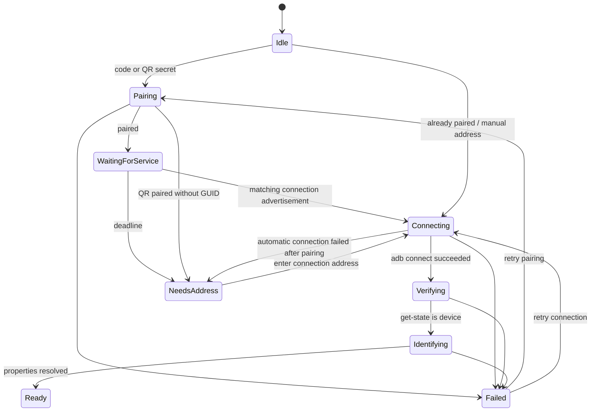

# macOS application architecture

The native application is an adapter around the existing scrcpy client. The
standalone CLI keeps its device selectors and appearance. Native app code stays
under `app/src/sys/macos`; cross-platform rendering uses the small `theme.h` and
`device_picker.h` boundaries rather than importing AppKit into C modules.

## Responsibilities

| Module | Responsibility | Lifetime / execution |
| --- | --- | --- |
| `device_support` | Validated endpoints, ADB properties, physical identity grouping, bounded commands and the reconnecting device watcher | Public lifecycle and completions on main; pipe I/O on workers |
| `device_pairing` | Ephemeral QR payloads and exact pairing/connection service matching | No UI or saved secrets |
| `device_connection` | Pair → discover connection service → connect → verify → identify | One cancellable workflow per Wi-Fi window |
| `device_wifi` | QR, code and manual forms, discovered choices and error presentation | AppKit main thread |
| `mirror_session` | Device launcher bundles, preparation, signing, argument replacement and existing-session discovery | Preparation off-main; completion on main |
| `device_picker` | Device-window presentation and coordination of discovery, identity queries and mirror requests | AppKit main thread; coalesced snapshots |
| `theme` | Shared preference, System appearance, theme menus/buttons and cross-process notifications | AppKit main thread |
| `theme_chooser` | First-launch selection and preview callbacks | UI only; no defaults or SDL dependency |
| `device_ui` | Shared appearance-aware controls, input geometry and icons | AppKit main thread |
| `window_ui` | Mirror titlebar, Dock badge, native menu integration and toast presentation | Adapts SDL windows to AppKit |

## Connection workflow

`SCDeviceConnectionPhase` is the single source of operational state. `busy` is
derived from the active phase, rather than independently writable UI flags.
The view mode is separately one of QR, pairing code or manual connection; this
avoids impossible QR-and-manual combinations. `paired` records a completed
protocol fact and survives connection-address fallback until cancellation or a
new pairing request.



Pairing codes travel through stdin, never command arguments or logs. Pairing
and connection ports are separate. A returned GUID takes precedence over a
host match, including after an IP change; another phone at the same IP must not
be substituted. A QR flow without a GUID falls back to a connection address.
Service parsing preserves names even when two advertisements share a port;
the code-entry device picker deduplicates endpoints only at presentation time.

All commands have bounded execution. Cancellation increments a generation,
stops the current process and deadline, and invalidates queued completions.
Closing or changing the Wi-Fi form cancels its workflow. A completed connection
reports serial and properties to the caller; it does not launch a window.

## Discovery and physical identity

`adb track-devices -l` is a change signal, not a transport-framing parser. The
manager debounces it into `adb devices -l` snapshots parsed by the existing C
parser. A periodic fallback runs while the watcher reconnects or discovery
fails. Only visible device windows own discovery timers and metadata queries.

USB, mDNS and literal IP transports are grouped by the phone's physical serial.
Unknown identities are not merged by model name or IP. A new transport waits
for its first identity result before appearing; existing rows remain stable
through reorder and retry. Closing the window stops discovery; reopening
re-queries inactive cached addresses because a reused IP can belong to a
different phone. Active-mirror identities are retained for alias reuse.

## Mirror lifecycle

A GUI mirror uses an independent process and disposable app bundle so its Dock
name can be the device brand/model. Preparation copies resources and signs the
copy on a worker; it never hard-links or re-signs the installed application.
`SCMirrorPreparation` supports cancellation and cleans up cancelled bundles.
The manager records pending preparations before accepting another request, so
a rapid second click or a known transport alias reuses the pending operation.

The UI distinguishes preparation/startup from a ready window. Readiness is
published only after the mirror is shown; **Show** activates an existing window.
Closing the manager cancels pending preparation, while already launched mirrors
continue independently. The event loop drains cancelled preparations so their
temporary bundles are cleaned before the manager process exits. Single-device startup pumps the main run loop until
background preparation finishes, keeping the parent alive without blocking UI
work on file copying or signing. Each mirror owns cleanup of its temporary
bundle at exit; the parent also cleans up launch failures.

## Theme and platform boundaries

The chooser reports previews without persisting them. Only acceptance updates
the saved theme. `theme` reads the host application's preference domain and
notifies independently running mirrors. System clears the explicit AppKit
appearance and follows macOS changes. SDL receives a theme event; hidden screens
skip frame rendering, and the screen update owns toolbar repainting to avoid
multiple repaints for one event. Explicit `--background-color` stays authoritative. Standalone CLI title labels
continue to use AppKit semantic colors, and its dark toast keeps white text;
the GUI preference does not override CLI window contrast.

Native bundle resources live in `Contents/Resources`, alongside signed native
executables in `Contents/MacOS`. GUI bundles require macOS 11 or later because
of SF Symbols and unified toolbars. Packaging also raises the minimum when a
bundled executable requires a newer OS, rejects external dylibs, and verifies
signatures after ZIP extraction. The standalone CLI's deployment target remains
separate from the GUI minimum.

## Review and regression coverage

The pre-commit review separated workflow from Wi-Fi views, moved preparation off
the main thread and separated the chooser from preference synchronization.
It also corrected same-port service-name loss, inactive identity-cache reuse,
rendering before the first frame, CLI title/toast contrast and the GUI
minimum-version declaration.

`test_device_connection` uses its own executable as an ADB fixture to cover stage
ordering, different pairing/connection ports, changed IPs, wrong GUIDs, fallback,
connection/state/identity failures, cancellation and the actual service deadline.
`test_mirror_session` covers signed copies, unchanged host bytes, asynchronous
completion and cancellation. `test_theme_chooser` sends native mouse and key
events without displaying a desktop window. Existing parser, identity, input,
CLI and toolbar tests remain in the full suite.

Run the native suite in a normal macOS graphics environment (Core Image QR
rendering may be unavailable inside a restricted sandbox):

```sh
meson test -C build-debug --print-errorlogs
meson compile -C release/work/build-macos-arm64 scrcpy
```

The current automated validation is 20 tests passing, plus Debug/arm64 Release
builds and strict bundle/archive signature checks. Manual end-to-end pairing
still depends on an available phone and Wi-Fi; fixture tests do not claim a
fresh real-device pairing session.
